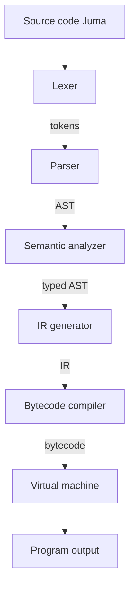

# Architecture

CompilerLab implements **Luma**, a small statically typed language, as a classic
multi-stage pipeline. Each stage lives in its own module, consumes the previous
stage's output and can be tested in isolation.

> Luma is a small compiler that targets a custom bytecode virtual machine which
> itself runs on the Python interpreter. It is **not** a native compiler: it does
> not produce `.exe` files or machine code.



## Stages

| Stage | Module | Responsibility |
| --- | --- | --- |
| Lexer | `lexer.py`, `tokens.py` | Turn characters into tokens with line/column positions. Reports lexical errors and keeps scanning. |
| Parser | `parser.py`, `ast.py` | Recursive-descent parser following the grammar in the language spec. Encodes precedence and associativity, recovers from syntax errors at statement boundaries. |
| Semantic analyzer | `semantic.py` | Name resolution, nested scopes, static type checking. The single authority on whether a program is valid. Records the static type of every expression. |
| IR generator | `ir_generator.py`, `ir.py` | Lowers the typed AST to a flat, stack-oriented IR with symbolic labels. Allocates local slots, inserts `TO_FLOAT` conversions and expands short-circuit `and`/`or` into jumps. |
| Bytecode compiler | `bytecode_compiler.py`, `bytecode.py` | Resolves labels to instruction addresses, appends `HALT`, validates the result. |
| Virtual machine | `vm.py` | Executes bytecode on an operand stack with numbered local slots. Reports every fault as a `VMError`. |
| Diagnostics | `errors.py` | One `Diagnostic` type (phase, message, line, column) shared by all front-end stages. |
| Facade | `compiler.py` | `Compiler.compile(source)` runs the whole pipeline and stops at the first stage that reports errors. `Compiler.check(source)` runs the front end only. |
| CLI | `cli.py`, `__main__.py` | `check`, `run`, `compile` and `disassemble` commands with stable exit codes. |

## Why both an IR and bytecode?

A language this small could be compiled from the AST straight to bytecode. The
IR is kept as a separate layer on purpose:

- IR uses **labels**; bytecode uses **resolved addresses**. Jump patching is a
  separate, testable step.
- Language semantics (scopes, slots, conversions, short-circuiting) are decided
  in the IR generator, while the instruction encoding is decided in the bytecode
  layer. A different VM or an optimiser could reuse the IR.

## Design decisions

- **The analyzer decides, later stages trust.** The IR generator never repeats
  semantic checks; it raises `IRError` only for internal inconsistencies.
- **No slot reuse.** Every declared variable gets a fresh local slot, even after
  its block ends. This makes correctness easy to argue; slot allocation is a
  natural future optimisation.
- **Typed operands, untyped opcodes.** `ADD` works on `int`, `float` and `string`
  operands. The VM checks that both operands have the same type, so the compiler
  must insert `TO_FLOAT` for mixed arithmetic. This is the contract between the
  IR generator and the VM, and the VM enforces it even for hand-written bytecode.
- **Short-circuit evaluation through jumps.** There are no `AND`/`OR` opcodes.
  `a and b` becomes `a; DUP; JUMP_IF_FALSE end; POP; b; end:`.
- **Validation at every boundary.** IR is validated before bytecode generation
  (labels, operand counts, slots). Bytecode is validated afterwards (operands,
  jump targets, slots, stack depth on every path, no fall-through past the end).
  The VM additionally checks everything at run time, so it is safe on its own.
- **Bounded execution.** The VM has an instruction limit (`--max-steps`), so
  infinite loops terminate with a controlled error.
- **64-bit integers.** Integer arithmetic that leaves the signed 64-bit range
  is a runtime error instead of silently growing like a Python `int`.
- **Diagnostics, not exceptions.** Invalid *source code* produces `Diagnostic`
  values; faults in a *running program* raise `VMError`. Python tracebacks are
  never part of the user interface.

## Bytecode

Instructions are `(opcode, operand?)` pairs addressed by index. Use
`luma compile FILE --emit-bytecode` to see the listing:

```
0000 CONST 10
0001 STORE_LOCAL 0
0002 LOAD_LOCAL 0
0003 CONST 2
0004 ADD
0005 PRINT
0006 HALT
```

| Opcode | Operand | Stack effect |
| --- | --- | --- |
| `CONST` | value | push value |
| `LOAD_LOCAL` / `STORE_LOCAL` | slot | push local / pop into local |
| `ADD SUBTRACT MULTIPLY DIVIDE MODULO` | | pop 2, push 1 |
| `EQUAL NOT_EQUAL LESS LESS_EQUAL GREATER GREATER_EQUAL` | | pop 2, push bool |
| `NEGATE NOT TO_FLOAT` | | pop 1, push 1 |
| `DUP` | | duplicate top of stack |
| `POP` | | discard top of stack |
| `PRINT` | | pop and print |
| `JUMP` | address | unconditional jump |
| `JUMP_IF_FALSE` | address | pop bool, jump if false |
| `HALT` | | stop (stack must be empty) |
